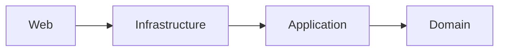

# Payments Service

[](https://github.com/chrifts/payments-service/actions/workflows/ci.yml)

A small payments API built with .NET 10 to practice Clean Architecture and Domain-Driven Design: a rich `Payment` aggregate, value objects that can't hold invalid data, a unit of work over EF Core, domain events, and tests against a real MySQL.

**Stack:** .NET 10 · ASP.NET Core minimal APIs · EF Core 9 (Pomelo) · MySQL 8.4 · xUnit · Testcontainers · NetArchTest · Serilog · GitHub Actions

## What it does

- Creates a payment for an amount due in a supported currency (EUR, USD, GBP, JPY, CLP, BTC) with a payment method (cash for now).
- Pays it: the cash tendered must cover the amount due. Paying an already paid payment changes nothing.
- Returns the payment and its status (`Pending` → `Paid`).
- Raises domain events (`PaymentCreatedEvent`, `PaymentPaidEvent`) and publishes them once they're saved (they're logged for now).

## API

| Method | Route | Responses |
|---|---|---|
| `POST` | `/payments` | `201 Created` + `Location` · `400` if a business rule is broken |
| `GET` | `/payments/{id}` | `200 OK` · `404` if it doesn't exist |
| `POST` | `/payments/{id}/pay` | `200 OK` with status `Paid` · `400` if the cash doesn't cover the amount · `404` |

```http
POST /payments
Content-Type: application/json

{
  "amountDue": 100.50,
  "currencyCode": "EUR",
  "paymentMethod": { "type": "cash", "tenderedAmount": 120 }
}
```

Errors are [Problem Details (RFC 9457)](https://www.rfc-editor.org/rfc/rfc9457) responses:

```json
{
  "type": "https://tools.ietf.org/html/rfc9110#section-15.5.1",
  "title": "A business rule was broken",
  "status": 400,
  "detail": "JPY allows at most 0 decimals, got 10.5.",
  "traceId": "00-…"
}
```

More requests, including the error cases, in [`Web/payments.http`](Web/payments.http).

## Architecture



| Layer | Contains |
|---|---|
| **Domain** | The `Payment` aggregate, value objects (`Money`, `Currency`, `PaymentId`), payment methods, domain events and exceptions, and the ports `IPaymentRepository`, `IUnitOfWork` and `IDomainEventPublisher`. No dependencies. |
| **Application** | One folder per use case (`CreatePayment`, `GetPayment`, `PayPayment`): a command or query plus a handler that only orchestrates. |
| **Infrastructure** | EF Core mappings for MySQL, the repository, the unit of work and the interceptor that publishes domain events. |
| **Web** | Minimal API endpoints, domain errors as Problem Details, JSON polymorphism and Serilog. |

The dependency rule is checked by architecture tests: Domain can't reference Application, Infrastructure or EF Core, and Application can't reference Infrastructure, Web, EF Core or ASP.NET Core.

## Design decisions

- **Value objects that can't be invalid.** `Money`, `Currency` and `PaymentId` are sealed records with get-only properties, validated when they're created. `Money` rejects more decimals than its currency allows (`JPY 10.5`), and a `with` expression can't bypass the rules.
- **A rich aggregate.** Payments are created through `Payment.Create(...)` and change only through `Pay()`; there are no public setters. Each payment method decides whether it can pay (`EnsureCanPay`), so `Payment` doesn't know the concrete type.
- **Guid v7 identifiers.** The domain generates `Guid.CreateVersion7()`, so a payment has its identity before it's saved and events can carry it. Version 7 is time-ordered, so it doesn't fragment InnoDB's clustered index the way random v4 GUIDs do.
- **Injected time.** `TimeProvider` is passed in (`FakeTimeProvider` in tests), so dates are deterministic.
- **Domain errors become 400s.** Broken business rules throw `DomainException` subclasses, and a single `IExceptionHandler` turns them into Problem Details. Any other exception is a bug: a 500 that doesn't leak its message.
- **Unit of Work.** The repository is a collection (`Add`, `GetByIdAsync`) and never saves. Use cases commit with `IUnitOfWork.SaveChangesAsync()`, implemented by the `DbContext`, which already is a unit of work.
- **Domain events after the commit.** An EF Core `SaveChangesInterceptor` takes the events of every tracked aggregate after a successful save and hands them to `IDomainEventPublisher`. It logs them today; an outbox can replace it without touching the domain.
- **TPH for payment methods.** EF Core can't map inheritance inside complex or owned types, so `PaymentMethod` is an entity (with a shadow key) in a single `PaymentMethods` table with a discriminator. Value objects are complex properties, and amounts use `decimal(28,8)`.
- **JSON polymorphism lives in the API.** The `type` discriminator (`"cash"`) is registered in the Web layer instead of with attributes on the Application record, so a new payment method doesn't modify the base type.
- **Fixed MySQL server version** (8.4.0) instead of `ServerVersion.AutoDetect`, which would open a connection every time the options are built.

### SOLID in practice

| Principle | Where |
|---|---|
| **S** | Handlers only orchestrate; the repository only stores; the interceptor decides *when* events are published and the publisher decides *how*. |
| **O** | A new payment method means new types (domain class, EF configuration, request record) plus two registrations (the TPH discriminator and the JSON `type`), without changing existing logic. A new business rule is a new `DomainException` subclass; a new interceptor is just registered. |
| **L** | `Payment.Pay` works with any `PaymentMethod`; any `IDomainEventPublisher` can replace the logging one. |
| **I** | Small ports: `IUnitOfWork` (one method), `IDomainEventPublisher` (one), `IHasDomainEvents` (two). `GetPayment` doesn't see anything that saves. |
| **D** | Application depends on ports defined in Domain, never on EF Core, and an architecture test checks it. |

## Running locally

Prerequisites: .NET 10 SDK and Docker.

1. Copy `.env.example` to `.env` and set `MYSQL_ROOT_PASSWORD` (and `MYSQL_HOST_PORT` if 3306 is taken).
2. Start MySQL:
   ```bash
   docker compose up -d
   ```
3. Store the connection string in user secrets, with the same password and port as `.env`:
   ```bash
   dotnet user-secrets set "ConnectionStrings:PaymentsDb" "server=localhost;port=3306;database=payments;user=root;password=<MYSQL_ROOT_PASSWORD>" --project Web
   ```
4. Install the EF Core CLI and create the database:
   ```bash
   dotnet tool restore
   dotnet ef database update --project Infrastructure --startup-project Web
   ```
5. Run the API at `http://localhost:5039` and try the requests in `Web/payments.http`:
   ```bash
   dotnet run --project Web
   ```

Logs go to the console and to daily files in `Web/logs/`. Sinks are configured in `appsettings.json` and levels per environment in `appsettings.{Environment}.json`.

## Tests

```bash
dotnet test                                            # everything (Docker must be running)
dotnet test --filter "FullyQualifiedName~Tests.Unit"   # unit tests only, no Docker needed
```

- **Unit:** domain rules (money, currencies, the payment lifecycle, cash) and application mapping.
- **Integration:** a real MySQL 8.4 container started by Testcontainers, with the real migrations. They cover the repository round trip, domain event publishing and the HTTP flow create → pay → get through `WebApplicationFactory`.
- **Architecture:** NetArchTest rules for the dependencies between layers.

CI runs the whole suite on every push and pull request to `main`.

## Roadmap

- Include the payment method details in the payment response.
- More payment methods: card (storing only the processor's token, never the card number), bank transfer, crypto.
- Optimistic concurrency, so two requests can't pay the same payment at the same time.
- A transactional outbox to deliver domain events reliably.
- An OpenAPI document and authentication.
